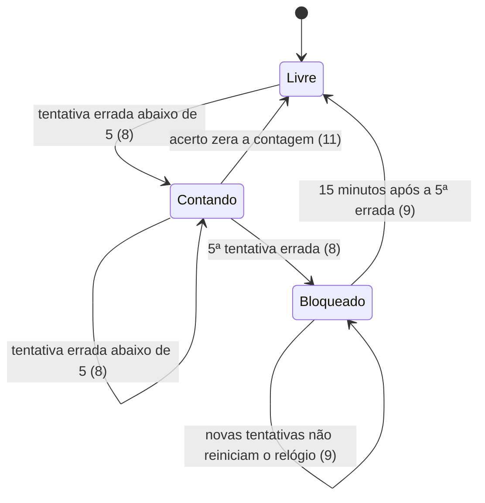

# Entrega 3 - Acesso pela casa: PIN familiar, H2 console desligado, frontend no .jar e início com o Windows

> Build this with **tlc-implement**.
> Every criterion below becomes a check with a proof, referenced by its number. Nothing under
> `Unresolved` gets settled while building.

## Intent

Hoje qualquer aparelho no Wi‑Fi de casa lê e apaga o banco. Não há PIN, o console do H2 (`/h2-console`, usuário `sa`, senha vazia) está ligado em `application.yml`, o frontend só roda com `npm run dev` separado do backend, e se o PC reinicia o servidor não volta sozinho. Quem paga é a família, cujos dados financeiros reais ficam acessíveis a qualquer dispositivo da rede (D1, D2).

Com esta entrega, cada aparelho informa o PIN familiar uma vez e fica liberado por 90 dias. O console do H2 deixa de existir. Um único `.jar` serve a API e o app na porta 8080, e um script registra o início automático do servidor no Windows.

14 abertos, dos quais 1 bloqueia e 1 bloqueia go-live · 30 critérios em 5 fatias · 3 portas sem retorno

## Criteria

### Acesso com PIN (API)

1. Dado que `FINANCE_PIN_HASH` não está definida, quando o `.jar` sobe, então o processo encerra com código de saída diferente de 0 e o log contém `Defina FINANCE_PIN_HASH` seguido do comando `--gerar-hash-pin`.
2. Quando `java -jar <jar do projeto> --gerar-hash-pin=1234` roda, então imprime uma linha com um hash BCrypt (prefixo `$2`), encerra com código 0 e a porta 8080 não abre.
3. Sem sessão válida, quando `GET /api/<rota>` é chamado para qualquer rota fora de `/api/auth/**`, então responde `401` com `message` = `PIN necessário`.
4. Quando `POST /api/auth/pin` recebe `{"pin":"<correto>"}`, então responde `204` e envia `Set-Cookie` com `HttpOnly`, `SameSite=Strict`, `Max-Age=7776000` e sem o atributo `Secure` (a casa é HTTP, D5).
5. Com o cookie do critério 4, quando `GET /api/profiles` é chamado, então responde `200`.
6. Quando `POST /api/auth/pin` recebe `{"pin":"<errado>"}`, então responde `401` com `message` = `PIN incorreto` e não envia cookie.
7. Se `POST /api/auth/pin` chega sem o campo `pin` ou com `pin` vazio, então responde `400` com `messages.pin` preenchido, no formato de erro de validação já existente.
8. Se o mesmo IP erra o PIN pela 5ª vez seguida, então essa resposta é `401` com `message` = `PIN incorreto`, e a partir daí todo `POST /api/auth/pin` desse IP responde `429` com `message` = `Muitas tentativas. Tente novamente em 15 minutos`, mesmo com o PIN correto.
9. Enquanto o IP está bloqueado, quando ele envia novas tentativas, então o relógio não reinicia: a primeira tentativa enviada 15 minutos após a 5ª errada, com o PIN correto, responde `204`.
10. Enquanto um IP está bloqueado, quando outro IP envia `POST /api/auth/pin` com o PIN correto, então recebe `204` normalmente, sem `429`.
11. Quando um IP erra 4 vezes, acerta na 5ª e depois erra mais 4 vezes, então nenhuma dessas respostas é `429`: o acerto zera a contagem.
12. Quando 10 `POST /api/auth/pin` com PIN errado chegam ao mesmo tempo do mesmo IP, então no máximo 5 respondem `401` e as demais respondem `429`.
13. Sempre, nenhuma linha de log contém o PIN enviado nem o valor de `FINANCE_PIN_HASH`.
14. Quando o servidor reinicia, então um cookie emitido antes da reinicialização continua válido e `GET /api/profiles` responde `200`. (Depende de Unresolved 1.)
15. Quando 90 dias se passam desde o `POST /api/auth/pin` que criou a sessão, então `GET /api/profiles` com esse cookie responde `401`, mesmo que o navegador ainda o tenha. (Depende de Unresolved 1.)
16. Quando um cookie alterado ou que não corresponde a nenhuma sessão é enviado, então `GET /api/profiles` responde `401` com `message` = `PIN necessário`. (Depende de Unresolved 1.)

### Tela de PIN (frontend)

17. Quando o app recebe `401` de `/api/**`, então mostra a tela de PIN com um campo de PIN e um botão Entrar, no lugar do dashboard.
18. Quando `POST /api/auth/pin` responde `204`, então a tela de PIN some e o dashboard carrega os dados sem recarregar a página.
19. Quando `POST /api/auth/pin` responde `401`, então a tela mostra `PIN incorreto` abaixo do campo.
20. Quando `POST /api/auth/pin` responde `429`, então a tela mostra o `message` recebido da API, `Muitas tentativas. Tente novamente em 15 minutos`.

### Frontend e H2 no `.jar`

21. Quando `GET /h2-console` é chamado, então responde `404`, com `spring.h2.console.enabled` igual a `false` no `application.yml`.
22. Quando `mvn package` roda, então o `.jar` gerado responde `GET /` com `200` e `Content-Type` `text/html` sem sessão, e os assets referenciados pelo HTML (`/assets/**`) respondem `200` sem sessão.
23. Sempre que o `.jar` está no ar e sem sessão, `GET /api/**` responde `401` enquanto `GET /` responde `200`.

### Início com o Windows

24. Quando `scripts/windows/instalar-inicio-automatico.ps1` roda, então cria a tarefa agendada `Personal Finance Tracker` com gatilho de logon, que executa o `.jar` com o JDK 21, e sai com código 0.
25. Quando o instalador roda uma segunda vez, então a tarefa é substituída e existe exatamente uma tarefa com esse nome.
26. Quando `scripts/windows/remover-inicio-automatico.ps1` roda com a tarefa instalada, então a tarefa deixa de existir e o script sai com código 0.
27. Se o instalador não encontra o JDK 21, então sai com código diferente de 0 e não cria tarefa.

### Regressão e documentação

28. Quando `mvn test` roda sem `FINANCE_PIN_HASH` definida, então termina com 0 falhas: a suíte usa um hash fixo em `src/test/resources/application.properties` e as chamadas de API enviam o cookie de uma sessão de teste.
29. Quando `mvn test` roda, então `data/finance.mv.db` não muda: o hash SHA-256 do arquivo é igual antes e depois. (Restrição já existente, coberta por `TestDatabaseIsolationTest`.)
30. Quando alguém segue o arquivo de `docs/` sobre acesso pela casa, então encontra os comandos para gerar o hash, definir `FINANCE_PIN_HASH` no usuário do Windows e rodar os dois scripts.

## States

## Out of scope

- Encerrar sessão (logout) - não está na issue; vira outra issue se for desejado
- Login individual por pessoa (D8) e HTTPS - a issue exclui
- Executar os scripts do Windows nesta máquina - a issue exclui; a prova deles é por leitura e análise estática, e quem executa é o usuário
- Bloqueio que sobrevive a reinício do servidor - ver Unresolved 14

## Observable

| Surface | Decision | Landing |
| --- | --- | --- |
| screen `PIN` | empty state | Unresolved 5 |
| screen `PIN` | loading state | Unresolved 5 |
| screen `PIN` | error state (401) | 19 |
| screen `PIN` | error state (429) | 20 |
| screen `PIN` | unauthorised state (qualquer `/api/**` com 401) | 17 |
| screen `PIN` | destructive action confirms | n/a - a tela só envia o PIN |
| API `POST /api/auth/pin` | error shape and codes | 6, 7, 8 (códigos 400, 401, 429); corpo do erro de 401 e 429 em Unresolved 7 |
| API `POST /api/auth/pin` | who may call | 4, 10 (qualquer aparelho da LAN com o PIN) |
| API `/api/**` guard | error shape and codes | 3 (401 com `message`) |
| API `/api/**` guard | rate limit | 8, 9, 12 |
| API `/api/**` guard | versioning | n/a - a API não tem versão hoje, e a issue não pede |
| `GET /h2-console` | error shape | 21 (404) |
| command `--gerar-hash-pin` | output format and verbosity | 2 |
| command `--gerar-hash-pin` | every flag and its default | Unresolved 10 (sem valor) |
| command `--gerar-hash-pin` | exit codes | 2 (0) e Unresolved 10 (erro) |
| command `--gerar-hash-pin` | failure halfway | n/a - imprime uma linha e encerra, não há etapa parcial |
| script `instalar-inicio-automatico.ps1` | every flag and its default | n/a - a issue não define parâmetros |
| script `instalar-inicio-automatico.ps1` | exit codes and failure halfway | 24 (0), 27 (JDK ausente) |
| script `remover-inicio-automatico.ps1` | exit codes | 26 (0) e Unresolved 12 (tarefa inexistente) |
| document `docs/` acesso pela casa | structure and next step | 30 |

## Swept

- validation: 7
- failure modes: 1, 6, 27
- idempotency and retry: 9, 25
- authorization: 3, 5, 16 (guard novo; nada existente cobre `/api/**`)
- concurrency and ordering: 12
- data lifecycle: 14, 15, 16 (sessões expiram após 90 dias); limpeza de linhas expiradas em Unresolved 1
- external-dependency failure: n/a - não há serviço externo; uma falha do H2 já é tratada pelo Spring, como hoje
- state transitions: 8, 9, 11 (diagrama em States)
- observability: 13 (nunca loga o PIN); o que mais logar em Unresolved 9

## Impact

| Front | What changes |
|---|---|
| domain | new term: `Sessão familiar` - cookie que libera `/api/**` por 90 dias, vive em `auth` |
| domain | new term: `Bloqueio por IP` - contagem de erros de PIN por IP e o bloqueio de 15 minutos, vive em `auth` |
| domain | existing term `PIN`: nenhum existe hoje; nada muda de significado |
| UI | `frontend/src/App.tsx`, função `getJson`: qualquer resposta não-ok vira "Não foi possível carregar os dados financeiros." Com o guard, um `401` cairia nessa mensagem genérica; precisa cair na tela de PIN (critério 17) |
| tests | `CategoryApiTest`, `FamilyAccountsTest`, `FamilyBudgetTest`, `TransactionDeletionTest` e `BackupControllerTest` chamam `/api/**` sem sessão e passam a receber `401` (critério 28) |
| config | `application.yml`: `spring.h2.console.enabled: true` passa a `false` (critério 21) |
| dev workflow | `npm run dev` com proxy para 8080: o navegador de desenvolvimento também passa pela tela de PIN |
| stored data | Unresolved 1 decide se a sessão vira tabela nova (migração Flyway); tabela nova não tem o que migrar |

## Decided

| Decision | Shape | Alternative rejected |
| --- | --- | --- |
| Hash do PIN em BCrypt, lido de `FINANCE_PIN_HASH` na subida | variável de ambiente com valor BCrypt (`$2a$` ou `$2b$`); sem variável, o servidor não sobe (critério 1) | PIN em texto ou SHA-256 sem salt: um PIN de 4 dígitos sai por tentativa bruta em segundos se o hash vazar |
| Cookie de sessão sem `Secure` | `HttpOnly; SameSite=Strict; Max-Age=7776000`, sem `Secure` (critério 4) | `Secure`: o navegador não envia o cookie em HTTP, e o login nunca funciona na Wi‑Fi de casa (D5) |
| Contrato de `POST /api/auth/pin` | entrada `{"pin": string}`; saída `204` com cookie, `401 {message}`, `429 {message}`, `400 {messages.pin}` | token no corpo JSON: a tela teria de guardar e reenviar o token, e o D6 pede cookie `HttpOnly` |

## Surface

| Route | In | Out | Status | Criteria |
| --- | --- | --- | --- | --- |
| `POST /api/auth/pin` | `pin` (string) | cookie de sessão (204); `message` (401, 429); `messages.pin` (400) | `204`, `400`, `401`, `429` | 4, 6, 7, 8 |
| `GET /api/**` (fora de `/api/auth/**`) | cookie de sessão | dados (200); `message` = `PIN necessário` (401) | `200`, `401` | 3, 5, 16 |
| `GET /h2-console` | - | - | `404` | 21 |
| `GET /` | - | HTML do React | `200` | 22, 23 |

## Sources

- Linear COD-12, *Entrega 3 - Acesso pela casa*, 10/10/2026 - fonte principal; os critérios de PIN, H2, frontend e Windows foram copiados dela
- `docs/decisions.md` D3, D4, D5, D6, D7, D33 - D4 diz "com o Windows", a issue diz "ao fazer logon": ver Unresolved 3
- `docs/product-spec.md` seção 2 - PIN familiar único, sem criação de conta
- Design - none: não há desenho da tela de PIN; a tela segue só o texto da issue (Unresolved 5)

This task is the record of decision. If a linked document diverges, ask before building.

## Unresolved

| # | Kind | Question | Until answered |
| --- | --- | --- | --- |
| 1 | blocks | Onde a sessão fica guardada: tabela `sessao` no H2 por migração Flyway (sobrevive a reinício) ou só em memória (some a cada reinício)? Recomendação: tabela, porque os 90 dias não fazem sentido se o PC reinicia e a família precisa digitar o PIN de novo | Critérios 14, 15 e 16 escritos assumindo tabela; os demais valem nos dois casos. Limpeza de linhas expiradas fica para o próximo login do mesmo aparelho |
| 2 | blocks go-live | Quem define o PIN real e grava `FINANCE_PIN_HASH` no usuário do Windows antes do primeiro uso? | Servidor não sobe sem a variável (critério 1); a entrega não pode ir ao ar até o usuário gerar o hash e rodar `setx` |
| 3 | open | Gatilho do início automático: logon (issue, critério 24) ou boot do Windows (D4, "com o Windows")? Recomendação: logon, porque dispensa administrador e a tarefa roda no mesmo usuário que tem a variável | Critério 24 escrito com logon |
| 4 | open | Formato do PIN: qualquer texto não vazio, ou só dígitos com tamanho mínimo? | Critério 7 valida só vazio |
| 5 | open | Desenho e copy da tela de PIN: texto do título, rótulo do campo, texto do botão, estado de carregamento e estado vazio | Critério 17 usa "campo de PIN e botão Entrar" sem layout |
| 6 | open | Nome do `.jar`: a issue diz `personal-finance-tracker.jar`, mas o `pom.xml` gera `personal-finance-tracker-0.0.1-SNAPSHOT.jar`. Recomendação: definir `<finalName>` no `pom.xml` | Critérios 2, 22 e 24 usam o nome da issue |
| 7 | open | Campo `error` do corpo de `401` e `429`: o handler atual só trata `IllegalArgumentException` e validação. Default: `Não autorizado` e `Muitas requisições` | Critérios 3, 6, 8 mantêm só o `message` |
| 8 | open | Como o frontend entra no `.jar`: copiar `frontend/dist` para `static/` durante o build, ou plugin Maven que baixa Node. Default: cópia, sem baixar Node | Critério 22 não fixa o mecanismo |
| 9 | open | O que logar além do PIN: default, um `WARN` por bloqueio com o IP e sem o PIN | Critério 13 só proíbe o PIN no log |
| 10 | open | `--gerar-hash-pin` sem valor: default, código 1 e mensagem de uso. O PIN na linha de comando fica no histórico do shell; prompt interativo seria mais seguro, mas é outra forma de uso | Critério 2 cobre só o caso com valor |
| 11 | open | O instalador localiza o JDK 21 por `JAVA_HOME`? Default: sim; sem `JAVA_HOME`, sai com erro (critério 27) | Critério 27 usa `JAVA_HOME` como fonte |
| 12 | open | `remover-inicio-automatico.ps1` com tarefa inexistente: default, sai com 0 e imprime aviso | Critério 26 cobre só o caso com tarefa |
| 13 | open | Versão de `spring-security-crypto` (ou outra lib BCrypt) como dependência nova do `pom.xml` | Critério 2 não fixa a biblioteca |
| 14 | open | Contagem de bloqueio em memória, que se perde ao reiniciar o servidor. Default: em memória; reiniciar o PC zera o bloqueio, mas a rede da casa não consegue reiniciar o servidor | Critérios 8 a 12 valem em memória |
