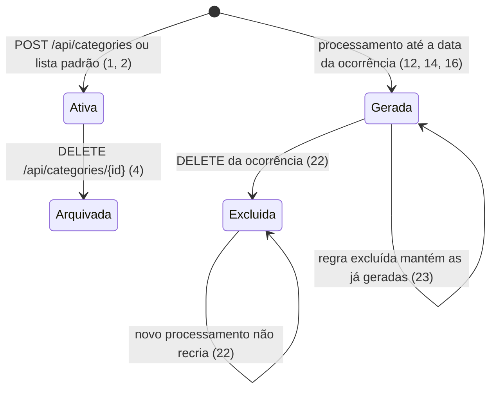
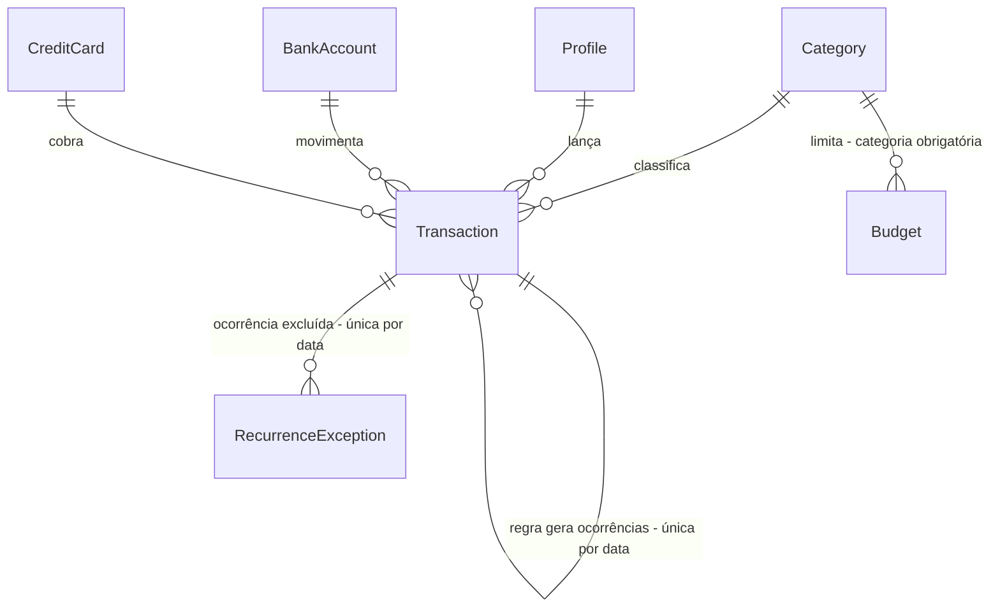

# Entrega 2 - Fundação de dados: Flyway, categorias, contas da família, recorrência e exclusão com estorno

> Build this with **tlc-implement**.
> Every criterion below becomes a check with a proof, referenced by its number. Nothing under
> `Unresolved` gets settled while building.

## Intent

Hoje o schema evolui por `ddl-auto: update` mais um `ALTER TABLE` manual, sem histórico, e não há como remover ou renomear colunas com segurança depois que a família começar a lançar dados reais. Categoria é texto livre ("Mercado", "mercado" e "Supermercado" viram três), então o orçamento por categoria deixa de bater. Contas e cartões pertencem a um único perfil e o lançamento é recusado quando a conta não é do responsável: a Maria não consegue registrar uma compra feita no cartão do João. Ocorrências recorrentes não mexem no saldo (um salário recorrente credita só no primeiro mês), uma ocorrência apagada seria recriada às 00:05 por comparação de campos, e recorrência em cartão quebra com `NullPointerException`. Por fim, não existe exclusão de nada: um lançamento errado fica para sempre e o saldo fica errado junto.

Com esta entrega, o banco nasce versionado pelo Flyway com categorias cadastráveis e uma lista padrão. Qualquer perfil lança em qualquer conta ou cartão da família, e o orçamento é da família por categoria e mês. A recorrência aplica o efeito de cada ocorrência ao vencer, e qualquer lançamento pode ser excluído com estorno de saldo, fatura e limite: parcelas excluem a compra inteira, uma ocorrência exclui só aquele mês e a regra encerra as futuras. O backup preserva tudo isso.

27 critérios em 6 fatias · 9 portas sem retorno · 4 abertos, dos quais 0 bloqueiam e 1 bloqueia o uso real

## Criteria

### S1 - Categorias cadastráveis

1. Dado um banco vazio, quando o servidor sobe, então `GET /api/categories` retorna `200` com 9 categorias, todas com `archived=false`: `EXPENSE` Alimentação, Moradia, Transporte, Lazer, Saúde, Educação, Outros; `INCOME` Salário, Outros.
2. Quando `POST /api/categories` recebe `{"name":"Pets","type":"EXPENSE"}`, então retorna `201` com `id`, `name`, `type` e `archived=false`, e a categoria aparece em `GET /api/categories?type=EXPENSE` e não aparece em `GET /api/categories?type=INCOME`.
3. Se `POST /api/categories` recebe um nome que já existe no mesmo tipo, sem diferenciar maiúsculas (`{"name":"alimentação","type":"EXPENSE"}`), então retorna `400` com `message` = `Categoria já existe`.
4. Quando `DELETE /api/categories/{id}` é chamado, então retorna `204`, a categoria some de `GET /api/categories`, aparece em `GET /api/categories?includeArchived=true` com `archived=true`, e os lançamentos que já a usavam continuam retornando esse `categoryId`.
5. Se um lançamento `EXPENSE` ou `INCOME` informa um `categoryId` inexistente, arquivado ou de tipo diferente do lançamento, então `POST /api/transactions` retorna `400` com `message` = `Categoria inválida para este lançamento`.
6. Quando uma `TRANSFER` é criada sem `categoryId`, então retorna `201`. Quando um `EXPENSE` ou `INCOME` é criado sem `categoryId`, então retorna `400` com `messages.categoryId`.

### S2 - Contas e cartões da família

7. Quando `POST /api/accounts` e `POST /api/credit-cards` são chamados sem `profileId`, então retornam `201`, e `GET /api/accounts` e `GET /api/credit-cards` listam todas as contas e cartões sem campo de perfil.
8. Dados os perfis Maria e João, uma conta "Conjunta" e um cartão "Nubank", quando Maria lança uma despesa na conta e outra no cartão, e João lança uma despesa na mesma conta, então os três lançamentos retornam `201`, cada um com o `profileId` de quem lançou.

### S3 - Orçamento da família

9. Dado um orçamento de R$ 500,00 para Alimentação em `2026-01`, criado sem `profileId`, quando Maria lança R$ 200,00 na conta em 10/01, João lança R$ 100,00 no cartão em 12/01 e alguém lança R$ 50,00 em 05/02, todos em Alimentação, então `GET /api/budgets/summary?month=2026-01` retorna `consumedAmount` = `300.00` e `consumedPercentage` = `60.00` para esse orçamento.
10. Dada uma compra de R$ 300,00 em 3x no cartão em 10/01/2026 em Alimentação, então o `consumedAmount` de Alimentação inclui R$ 100,00 em `2026-01`, `2026-02` e `2026-03`.
11. Se `POST /api/budgets` recebe uma categoria e um mês que já têm orçamento, então retorna `400` com `message` = `Já existe orçamento para esta categoria neste mês`.

### S4 - Recorrência que move o saldo

12. Dada uma despesa recorrente de R$ 900,00 em 15/01/2026 numa conta com saldo de R$ 1.000,00, quando a recorrência é processada até 15/03/2026, então existem 3 lançamentos (15/01, 15/02, 15/03), os de fevereiro e março ligados ao primeiro como regra, e o saldo da conta é R$ -1.700,00.
13. Quando o processamento roda duas vezes até a mesma data, então a segunda execução não cria lançamentos e não altera o saldo.
14. Dada uma assinatura recorrente de R$ 40,00 no cartão em 05/01/2026, quando processada até 05/02/2026, então existem 2 lançamentos, cada um somado à fatura do seu mês de vencimento, e o limite disponível caiu R$ 80,00.
15. Quando o processamento recebe uma data posterior a hoje, então nenhuma ocorrência com data posterior a hoje é criada.
16. Quando o servidor sobe, então as ocorrências vencidas até hoje são geradas, sem esperar o agendamento das 00:05.

### S5 - Exclusão com estorno

17. Quando `DELETE /api/transactions/{id}` é chamado numa despesa de R$ 200,00 em conta, então retorna `204`, o lançamento some de `GET /api/transactions` e o saldo da conta aumenta R$ 200,00.
18. Quando uma receita de R$ 300,00 em conta é excluída, então o saldo da conta diminui R$ 300,00.
19. Quando uma transferência de R$ 500,00 é excluída, então o saldo da conta de origem aumenta R$ 500,00 e o da conta de destino diminui R$ 500,00.
20. Quando uma compra de R$ 150,00 no cartão é excluída, então a fatura correspondente diminui R$ 150,00 e o limite disponível aumenta R$ 150,00.
21. Dada uma compra de R$ 300,00 em 3x no cartão, quando qualquer uma das parcelas é excluída, então as 3 parcelas somem, cada uma das 3 faturas diminui R$ 100,00 e o limite disponível aumenta R$ 300,00.
22. Dada uma regra recorrente com ocorrências em fevereiro e março, quando a ocorrência de fevereiro é excluída, então o efeito dela é estornado, e um novo processamento até 15/03/2026 não recria fevereiro e mantém março.
23. Quando a regra recorrente (o primeiro lançamento) é excluída, então o efeito dela é estornado, as ocorrências já geradas permanecem, e um processamento posterior não cria novas ocorrências.
24. Se `DELETE /api/transactions/{id}` recebe um id inexistente, então retorna `400` com `message` = `Transação não encontrada`.

### S6 - Backup com a nova estrutura

25. Quando um estado com categoria personalizada, categoria arquivada, compra parcelada, regra recorrente com uma ocorrência excluída e orçamento é exportado em JSON e importado, então: as categorias voltam com o mesmo nome, tipo e `archived`; lançamentos e orçamentos apontam para elas; excluir uma parcela remove as 3; e processar a recorrência não duplica ocorrências nem recria a excluída.
26. Quando o mesmo estado do critério 25 é exportado em CSV e importado, então o resultado é o mesmo do critério 25.
27. Se o arquivo de backup referencia um `categoryId` que não está em `categories`, então a importação retorna `400` com `message` contendo `Backup inválido`.

## States

## Out of scope

- Telas para categorias, contas, orçamento ou exclusão - entrega 4; o frontend atual só lê `/api/accounts` e `/api/budgets/summary`
- PIN e restrição de acesso - entrega 3
- Pagamento de fatura e status de fatura paga - entrega 5
- Edição de lançamentos - entrega 7
- Parcelamento em conta (sem cartão) continua debitando todas as parcelas na criação - ver Unresolved 3
- Metas (`Goal`) continuam vinculadas a um perfil - ver Unresolved 5
- Projeções de lançamentos futuros - roadmap

## Observable

| Surface | Decision | Landing |
| --- | --- | --- |
| API `GET /api/categories` | response shape | 1, 2, 4 |
| API `GET /api/categories` | empty state | n/a - a lista padrão garante pelo menos 9 itens (1) |
| API `POST /api/categories` | error shape and codes | 3 |
| API `DELETE /api/categories/{id}` | error shape and codes | existing - `IllegalArgumentException` vira `400` com `message` no `GlobalExceptionHandler` |
| API `POST /api/transactions` | error shape and codes | 5, 6 |
| API `DELETE /api/transactions/{id}` | response and error shape | 17, 24 |
| API `POST /api/budgets` | error shape and codes | 11; existing - `GlobalExceptionHandler`, `400` com `message`/`messages` |
| API `POST /api/backup/import` | error shape | 27; existing - `IllegalArgumentException` vira `400` |
| todas as APIs | quem pode chamar | n/a - PIN é a entrega 3 |
| todas as APIs | versionamento | n/a - o único consumidor é o próprio frontend, que só lê `/api/accounts`, `/api/goals`, `/api/profiles` e `/api/budgets/summary` |
| todas as APIs | rate limit | n/a - servidor na rede de casa |
| comando agendado `RecurringTransactionScheduler` | saída e falha no meio | existing - método `@Transactional`, uma falha desfaz a execução inteira e a próxima execução refaz |

## Swept

- validation: 3, 5, 6, 11, 27
- failure modes: 24; existing - cada operação de escrita roda em `@Transactional` e uma falha desfaz o estorno inteiro
- idempotency and retry: 13
- authorization: n/a - sem controle de acesso até a entrega 3
- concurrency and ordering: n/a - uma única JVM processa a recorrência. Se a execução na inicialização e a das 00:05 coincidirem, a restrição única de `Decided` linha 6 impede a ocorrência duplicada e a segunda execução é desfeita
- data lifecycle: 4, 25, 26; banco atual descartado (Unresolved 4)
- external-dependency failure: n/a - Flyway roda localmente contra o H2, sem serviço externo
- state transitions: 4, 22, 23
- observability: n/a - logs padrão do Spring Boot

## Impact

| Front | What changes |
|---|---|
| domain | new term: `Category` - categoria de lançamento com `name`, `type` (`INCOME`/`EXPENSE`) e `archived`, lives in module `category` |
| domain | existing term: `Transaction.category` era texto livre e passa a ser referência a `Category` (`categoryId`). Quem usa hoje: `TransactionService`, `BudgetService` (compara com `equalsIgnoreCase`), `BackupController`, `BackupExport` e os testes |
| domain | existing term: `BankAccount`/`CreditCard` pertenciam a um `Profile` e passam a ser da família. Quem usa hoje: `TransactionService` (3 validações "não pertence ao perfil"), `Profile` (`cascade = ALL` em `accounts`/`cards`), `BankAccountService`, `CreditCardService`, `BackupController` |
| domain | existing term: `Budget` pertencia a um `Profile` e passa a ser da família. Quem usa hoje: `BudgetService.getBudgetSummary` (filtra por perfil), `Profile.budgets`, `BackupController` |
| domain | existing term: uma transação `recurring=true` era a regra e a origem das cópias identificadas por comparação de campos; agora as ocorrências apontam para a regra. Quem usa hoje: `TransactionService.generateRecurringTransactions` |
| API | `TransactionRequest.category` vira `categoryId`; `BudgetRequest` perde `profileId` e troca `category` por `categoryId`; `BankAccountRequest` e `CreditCardRequest` perdem `profileId`. `BudgetSummary` mantém `category` (agora o nome da categoria) e ganha `categoryId`, então o frontend continua funcionando |
| tests | `RecurringTransactionSchedulerTest` (linha 51) e `TransactionServiceTest.generateRecurringTransactions...` (linha ~146) esperam que as ocorrências não mexam no saldo e mudam para o comportamento do critério 12 (aprovado: resposta "2 - a"). Os demais testes trocam `category` texto por `categoryId` e perdem `profileId` de conta, cartão e orçamento |
| stored data | nothing to migrate - o banco atual só tem dados de teste e é descartado (D16, Unresolved 4). `V1` cria o schema do zero |

## Decided

| Decision | Shape | Alternative rejected |
|---|---|---|
| Flyway como único mecanismo de schema | dependência `org.flywaydb:flyway-core` (versão gerenciada pelo Spring Boot); `src/main/resources/db/migration/V1__baseline.sql` (schema completo) e `V2__default_categories.sql` (9 categorias); `spring.jpa.hibernate.ddl-auto: validate`; remove `TransactionSchemaMigration` | `ddl-auto: update` - sem histórico e não remove nem renomeia colunas, o que já forçou um `ALTER TABLE` manual |
| Tabela de categorias | `categories(id BIGINT identity, name VARCHAR not null, type VARCHAR not null, archived BOOLEAN not null default false)` com unicidade em `(LOWER(name), type)` | texto livre - orçamentos não batem; enum - não é personalizável (D14) |
| Categoria nas transações e orçamentos | `transactions.category_id` FK para `categories`, nulo só em `TRANSFER`; `budgets.category_id` FK not null | manter a coluna texto ao lado - duas fontes da verdade |
| Contas e cartões sem dono | `bank_accounts` e `credit_cards` sem `profile_id`. Fecha: um saldo por pessoa no futuro exigiria recriar o vínculo | manter o dono e filtrar no "pagar com" - não reflete a conta conjunta (resposta "1 - a") |
| Orçamento sem dono | `budgets` sem `profile_id` | orçamento por perfil - multiplica o cadastro sem ganho (D16) |
| Vínculo da ocorrência com a regra | `transactions.recurrence_source_id` FK para `transactions(id)` `ON DELETE SET NULL`, com unicidade em `(recurrence_source_id, date)` | comparação de campos (descrição, valor, data) - recria ocorrência apagada e quebra se a regra muda |
| Ocorrências excluídas | `recurrence_exceptions(source_transaction_id FK ON DELETE CASCADE, occurrence_date)` com unicidade no par | flag de exclusão lógica em `transactions` - toda consulta de extrato, saldo e orçamento precisaria filtrar |
| Grupo de parcelas | `transactions.installment_group_id BIGINT` nulo, igual ao `id` da parcela 1 em todas as parcelas do grupo | identificar parcelas pelo sufixo "Parcela i/N" da descrição - quebra com edição e com descrições repetidas |
| Formato do backup | ganha `categories[]` (`id`, `name`, `type`, `archived`) e `recurrenceExceptions[]` (`sourceTransactionId`, `occurrenceDate`); transações ganham `categoryId`, `installmentGroupId` e `recurrenceSourceId` e perdem `category`; orçamentos trocam `category` por `categoryId` e perdem `profileId`; contas e cartões perdem `profileId`. As colunas CSV seguem os mesmos nomes. Backups no formato antigo não são aceitos | manter compatibilidade com o formato antigo - não existe nenhum backup real nele |

## Relations

## Surface

| Route | In | Out | Status | Criteria |
|---|---|---|---|---|
| `GET /api/categories` | `type?`, `includeArchived?` | `id`, `name`, `type`, `archived` | `200` | 1, 2, 4 |
| `POST /api/categories` | `name`, `type` | `id`, `name`, `type`, `archived` | `201`, `400` | 2, 3 |
| `DELETE /api/categories/{id}` | - | - | `204` | 4 |
| `POST /api/transactions` | `categoryId` (substitui `category`) | inclui `categoryId` | `201`, `400` | 5, 6, 8 |
| `DELETE /api/transactions/{id}` | - | - | `204`, `400` | 17-24 |
| `POST /api/accounts`, `POST /api/credit-cards` | sem `profileId` | sem perfil | `201` | 7 |
| `POST /api/budgets` | `categoryId`, `limitAmount`, `month` (sem `profileId`) | - | `201` | 9 |
| `GET /api/budgets/summary` | `month` | ganha `categoryId`; `category` passa a ser o nome | `200` | 9, 10 |

## Sources

- `docs/decisions.md` - D12 (Flyway, banco limpo), D14 (categoria como entidade com tipo e lista padrão), D15 (arquivar), D16 (orçamento da família), D17 (compra conta no mês da compra; parcela no mês da parcela), D19 (exclusão com estorno; excluir parcela remove todas), D21 ("pagar com" lista contas e cartões), D25 (recorrência roda ao iniciar)
- Conversa de 10/10/2026 (sem endereço): "recusar duplicado" - critério 11; "1 - a" - contas e cartões da família, sem dono; "2 - a" - ocorrência aplica efeito ao vencer, liga à regra, exclusão de ocorrência não recria, exclusão da regra encerra futuras e mantém passadas, cartão aceita recorrência, testes atuais corrigidos
- `docs/decisions.md` "Em aberto": "Excluir uma ocorrência recorrente apaga só aquela ocorrência ou também encerra a regra?" - resolvido pela resposta "2 - a"

This task is the record of decision. If a linked document diverges, ask before building.

## Unresolved

| # | Kind | Question | Until answered |
|---|---|---|---|
| 4 | blocks go-live | O arquivo `data/finance.mv.db` atual (dados de teste) precisa ser apagado antes de subir esta versão: o Flyway recusa um banco que já tem tabelas e não tem histórico | O servidor não sobe na máquina do usuário até o arquivo ser apagado; os testes usam H2 em memória e não dependem disso |
| 2 | open | O processamento manual (`POST /api/transactions/{id}/recurrences?until=`) com data futura deve ser limitado a hoje? | Critério 15 escrito com esse padrão: nada com data futura é materializado; projeções ficam no roadmap |
| 3 | open | Parcelamento em conta (sem cartão) continua debitando todas as parcelas na criação? | Mantido como está (fora do escopo); o estorno do critério 21 vale para cartão |
| 5 | open | Metas (`Goal`) continuam vinculadas a um perfil? | Mantidas como estão; nenhum critério toca metas |
