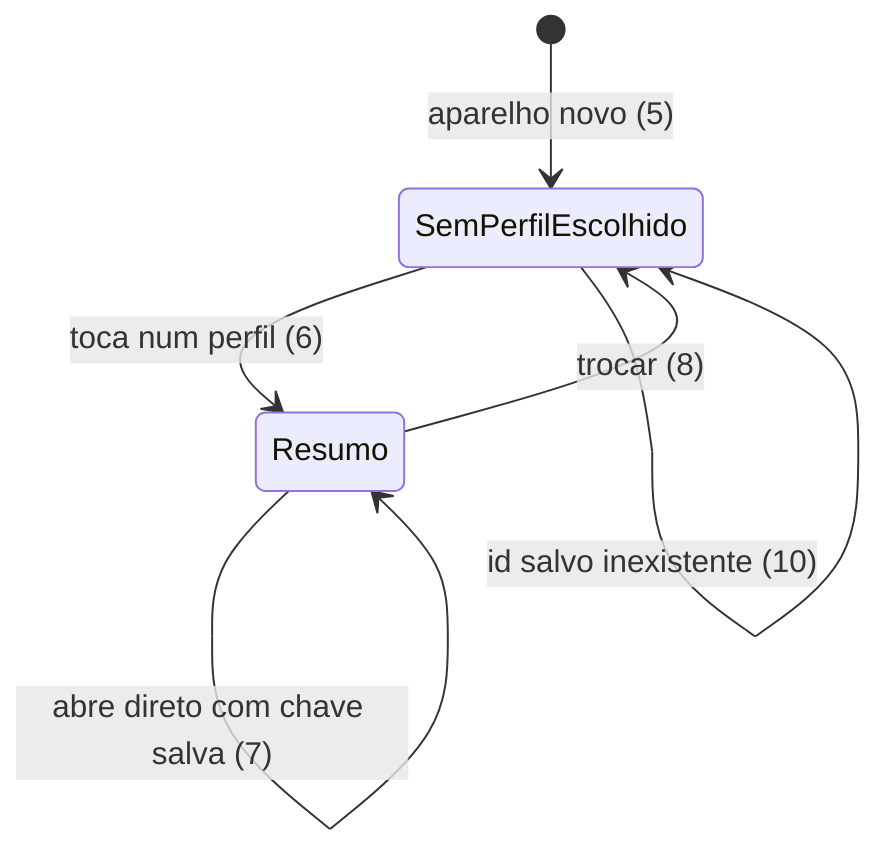

# Entrega 4 - Lançamento rápido pelo celular e extrato do mês

> Build this with **tlc-implement**.
> Every criterion below becomes a check with a proof, referenced by its number. Nothing under
> `Unresolved` gets settled while building.

## Intent

Hoje lançar um gasto exige abrir um formulário com todos os campos, e o único jeito de ver o que
aconteceu no mês é olhar a lista inteira de lançamentos, que não filtra por mês nem por pessoa. A família
usa o celular na maior parte das vezes, e a tela atual é um painel de leitura que não permite lançar nada.
Quem paga é quem precisa registrar um gasto logo depois de fazê-lo, e quem quer saber quanto entrou e saiu
no mês, sem somar à mão.

Com esta entrega, cada aparelho escolhe "quem sou eu" uma vez. Um formulário rápido, pensado para o celular,
registra uma despesa com três toques: valor, categoria e "pagar com". Campos menos usados ficam em "mais
opções". O extrato do mês mostra a família inteira, com filtro por pessoa, totais de entradas, saídas e saldo,
e navegação entre meses. Para isso, cadastros mínimos de perfis, contas e cartões já ficam disponíveis no app.

Status: 0 abertos bloqueiam · 5 abertos (open) · 30 critérios em 6 fatias · 3 portas sem retorno

## Criteria

### S1 - Extrato filtra por mês e por pessoa (API)

1. Quando `GET /api/transactions?month=2026-01` é chamado, então devolve só os lançamentos com `date` entre 2026-01-01 e 2026-01-31, do mais recente para o mais antigo.
2. Quando `GET /api/transactions?month=2026-01&profileId=<maria>` é chamado, então devolve só os lançamentos de Maria naquele mês.
3. Se `month` não está no formato `YYYY-MM`, então responde `400` com `message` = `Mês inválido, use o formato AAAA-MM`.
4. Quando `GET /api/transactions` é chamado sem parâmetros, então devolve todos os lançamentos, como hoje.

### S2 - Quem sou eu por aparelho

5. Dado um aparelho sem escolha salva, quando o app abre, então mostra a tela "Quem é você?" com a lista de perfis e nenhum dashboard.
6. Quando o usuário toca num perfil na tela "Quem é você?", então a escolha é gravada no `localStorage` na chave `quem-sou-eu` com o id do perfil, e o app vai para o Resumo.
7. Dado que a chave `quem-sou-eu` já existe, quando o app recarrega, então abre direto no Resumo sem perguntar.
8. Quando o usuário toca em "trocar" no cabeçalho, então a lista de perfis aparece de novo, e a escolha nova substitui a anterior na mesma chave.
9. Se não existe nenhum perfil cadastrado, então a tela "Quem é você?" mostra um botão que leva ao cadastro de perfil (critério 13).
10. Se a chave `quem-sou-eu` contém um id de perfil que não existe mais, então a tela "Quem é você?" aparece de novo, sem quebrar.

### S3 - Cadastro mínimo de perfis, contas e cartões

11. Quando um perfil é cadastrado com `name` = `Maria`, então `POST /api/profiles` responde `201` e o perfil aparece na lista de quem sou eu.
12. Quando uma conta é cadastrada com `name`, `type` e saldo inicial, então `POST /api/accounts` responde `201` e a conta aparece em "pagar com".
13. Quando um cartão é cadastrado com `name`, `limitAmount`, dia de fechamento e dia de vencimento, então `POST /api/credit-cards` responde `201` e o cartão aparece em "pagar com" para despesas.
14. Se o cadastro de cartão recebe dia de fechamento fora de 1 a 31, então responde `400` e a tela mostra a mensagem do campo, sem limpar o formulário.

### S4 - Lançamento rápido

15. Quando o formulário abre, então o tipo está em `Despesa`, a data é a de hoje e o valor, a categoria e "pagar com" estão vazios.
16. Quando o usuário lança `R$ 42,50` em `Alimentação` pagando com a conta `Conjunta`, sem abrir "mais opções", então `POST /api/transactions` é enviado com `type` = `EXPENSE`, `amount` = `42.50`, `categoryId` da Alimentação, `accountId` da Conjunta, `date` = hoje e `profileId` = o de quem sou eu, e a resposta `201` limpa o valor e mostra `Lançamento salvo`.
17. Se o valor está vazio ou é zero, então o botão Salvar fica desabilitado e nada é enviado.
18. Quando o tipo é `Receita`, então "pagar com" lista só as contas, nunca cartões.
19. Quando o tipo é `Despesa`, então "pagar com" lista contas e cartões numa lista só, com cartões identificados como tal.
20. Quando o usuário escolhe um cartão em "pagar com", então o envio usa `creditCardId` e não `accountId`.
21. Quando o usuário abre "mais opções", então aparecem descrição, data, parcelas (só para cartão, de 1 a 24), recorrência e, para `Transferência`, conta de destino.
22. Quando o usuário escolhe um cartão e `parcelas` = 3 em "mais opções", então são enviadas 3 parcelas com datas em meses consecutivos, e o formulário mostra `Lançamento salvo em 3 parcelas`.
23. Se a descrição está vazia, então o envio usa o nome da categoria como descrição (default, ver Unresolved 1).
24. Se o servidor responde `400`, então a tela mostra a mensagem recebida, sem limpar o formulário.
25. Enquanto o envio está em andamento, o botão Salvar fica desabilitado, e dois toques rápidos geram um único lançamento.

### S5 - Extrato do mês

26. Quando o Extrato abre, então mostra o mês atual, os lançamentos da família inteira, com totais de `Entradas` (soma das receitas), `Saídas` (soma das despesas) e `Saldo` = entradas − saídas.
27. Quando o usuário escolhe "Maria" no filtro de pessoa, então a lista e os três totais passam a considerar só os lançamentos de Maria.
28. Quando o usuário toca em "mês anterior" ou "próximo mês", então o mês muda, a lista é recarregada e o título mostra o mês escolhido (ex.: `Janeiro de 2026`).
29. Transferências aparecem na lista mas não entram em `Entradas`, `Saídas` nem `Saldo`.
30. Se o mês não tem lançamentos, então a lista mostra `Nenhum lançamento neste mês` e os totais são `R$ 0,00`.

### S6 - Base de estilo e navegação no celular

31. Quando o app abre em largura de 375px, então não há rolagem horizontal da página (`scrollWidth` ≤ `clientWidth`) em Resumo, Lançar e Extrato.
32. Sempre, a navegação inferior tem três abas: `Resumo`, `Lançar`, `Extrato`, e a aba ativa é destacada.
33. Quando o app carrega, então o CSS vem do Tailwind e `App.css` deixa de existir.

## States

## Out of scope

- Editar e excluir lançamentos pelo extrato - entrega 7 (D19)
- Pagamento de fatura - entrega 5
- Exportar planilha e telas de orçamento e metas - entrega 7
- Persistir "quem sou eu" no servidor - D20 é por aparelho
- Login por pessoa - D8

## Observable

| Surface | Decision | Landing |
| --- | --- | --- |
| screen "Quem é você?" | empty state (sem perfis) | 9 |
| screen "Quem é você?" | error state (id inválido salvo) | 10 |
| screen "Quem é você?" | loading state | Unresolved 2 |
| screen Lançar | empty state (campos vazios) | 15 |
| screen Lançar | error state (400) | 24 |
| screen Lançar | loading state | 25 |
| screen Lançar | destructive action confirms | n/a - não há exclusão nesta entrega |
| screen Extrato | empty state (mês sem lançamentos) | 30 |
| screen Extrato | error state (falha de rede) | Unresolved 2 |
| screen Extrato | loading state | Unresolved 2 |
| screen Cadastro | error state (400) | 14 |
| API `GET /api/transactions` | error shape and codes | 3 (400) |
| API `POST /api/transactions` | retry after timeout | Unresolved 3 |
| API `GET /api/transactions` | who may call | existing - guard de PIN de `/api/**` |
| API `GET /api/transactions` | versioning | n/a - API sem versão |
| document | - | None - no user-facing document |

## Swept

- validation: 3, 14, 17, 24
- failure modes: 24, Unresolved 3
- idempotency and retry: 25 (um toque gera um lançamento); retry após timeout em Unresolved 3
- authorization: existing - guard de PIN de `/api/**` (entrega 3)
- concurrency and ordering: 25; ordem do extrato em 1 (mais recente primeiro)
- data lifecycle: n/a - nenhum dado novo é guardado; `quem-sou-eu` é só o id no aparelho
- external-dependency failure: 24 e Unresolved 2 (falha de rede no extrato)
- state transitions: diagrama em States (5 a 10)
- observability: n/a - sem requisito de log nesta entrega

## Impact

| Front | What changes |
|---|---|
| domain | new term: `Quem sou eu` - id do perfil escolhido por aparelho, vive só no `localStorage` do aparelho |
| domain | new term: `Mês do extrato` - `YYYY-MM` que filtra lançamentos pela data, vive em `transaction` |
| domain | existing term `Transferência`: nos totais de extrato ela não é entrada nem saída (D18); antes nenhum total existia |
| API | `GET /api/transactions` ganha parâmetros opcionais `month` e `profileId`; sem eles, o comportamento é o de hoje |
| UI | `frontend/src/App.tsx` vira o Resumo; `App.css` sai e o estilo passa a ser Tailwind |
| UI | `frontend/package.json`: novas dependências `tailwindcss`, `@tailwindcss/vite` e `zustand` |
| stored data | nada a migrar: nenhuma tabela nova |

## Decided

| Decision | Shape | Alternative rejected |
| --- | --- | --- |
| Filtro do extrato no servidor por mês | `GET /api/transactions?month=AAAA-MM`, opcional; `month` filtra `date` entre o dia 1 e o último dia do mês. `profileId` existe na API, mas o app filtra a pessoa no celular | filtrar o mês no app: cada celular baixaria todo o histórico a cada troca de mês |
| Tailwind v4 pelo plugin do Vite | `tailwindcss` e `@tailwindcss/vite` em `devDependencies`; CSS único em `index.css` com `@import "tailwindcss"` | Tailwind v3 com PostCSS: config extra e versão em fim de ciclo; CSS puro: rejeitado na D13 |
| Zustand com `persist` para "quem sou eu" | store com chave `quem-sou-eu` no `localStorage`, guardando só o id do perfil | Context do React: some ao recarregar sem `persist` manual; estado no servidor: D20 manda ser por aparelho |

## Surface

| Route | In | Out | Status | Criteria |
| --- | --- | --- | --- | --- |
| `GET /api/transactions` | `month` (AAAA-MM, opcional), `profileId` (opcional) | lista de lançamentos; `message` no 400 | `200`, `400` | 1, 2, 3, 4 |

## Sources

- Linear COD-13, *Entrega 4 - Lançamento rápido pelo celular e extrato do mês*, 10/10/2026 - fonte principal
- `docs/decisions.md` D5 (responsivo, celular primeiro), D13 (Tailwind e Zustand), D17 (compra conta no mês da compra), D18 (transferência não é despesa), D19 (sem edição nesta entrega), D20 (quem sou eu por aparelho), D21 (campos do formulário rápido), D22 (extrato da família com filtro por pessoa)
- `docs/product-spec.md` seção de lançamentos
- Design - none: não há desenho das telas; copy e layout seguem o texto desta task (Unresolved 2)

This task is the record of decision. If a linked document diverges, ask before building.

## Unresolved

| # | Kind | Question | Until answered |
| --- | --- | --- | --- |
| 1 | open | Descrição no lançamento rápido. O `TransactionRequest` exige descrição, e o D21 deixa a descrição em "mais opções". Default: a descrição vazia vai como o nome da categoria, sem mudar o backend. Alternativa: aceitar descrição vazia no backend | Critério 23 usa o nome da categoria como descrição |
| 2 | open | Copy, estados de carregamento e de erro das telas "Quem é você?" e Extrato, e o layout final. Não há desenho. Default: textos em PT-BR neste documento e carregamento como texto centralizado | Critérios com `loading` e `error` de tela escritos sem layout |
| 3 | open | Reenvio depois de timeout no lançamento. Se a rede cai depois de o servidor gravar, um novo envio duplica o lançamento. Default: nenhum reenvio automático; a tela mostra o erro e o usuário confere no Extrato | Nenhum critério de retry automático; o caso fica sem proof |
| 4 | open | Navegação do Extrato para meses futuros. Default: permitido | Critério 28 permite qualquer mês |
| 5 | open | Onde fica a troca de "quem sou eu". Default: botão no cabeçalho do Resumo | Critério 8 não fixa a posição |
