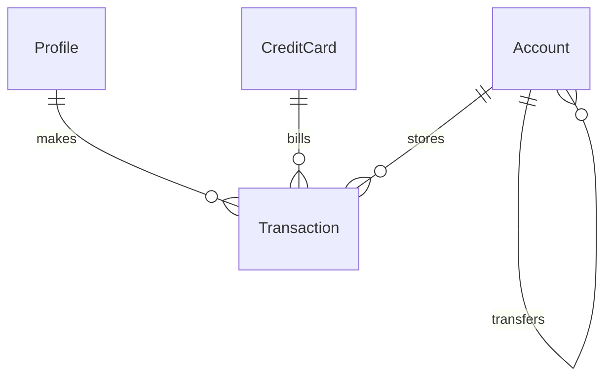

# Personal Finance Tracker MVP - Fundação, Domínio e Lançamentos

> Build this with **tlc-implement**.
> Every criterion below becomes a check with a proof, referenced by its number. Nothing under
> `Unresolved` gets settled while building.

## Intent

Atualmente, famílias não possuem uma ferramenta local, privada e sem atritos para consolidar receitas, despesas, contas bancárias e cartões de crédito sem depender de nuvem ou login externo. Isso força o uso de planilhas complexas ou aplicativos que exigem assinatura e comprometem a privacidade dos dados financeiros.

Com esta entrega, a aplicação passa a permitir o gerenciamento local completo de perfis familiares, contas bancárias, cartões de crédito, transações (receitas, despesas, transferências, recorrência e parcelamentos), além de exportação e importação manual para backup/sincronização entre dispositivos.

12 critérios em 4 fatias · 2 portas sem retorno · 0 abertos, dos quais 0 bloqueiam

## Criteria

### Perfis e Contas Bancárias

1. Dado que o sistema foi inicializado, quando o usuário cadastra um perfil familiar com nome, então o perfil é persistido com ID único e exibido na lista de responsáveis.
2. Dado que existem perfis cadastrados, quando o usuário cria uma conta bancária informando nome, tipo (Corrente, Poupança, Carteira, Investimentos) e saldo inicial, então a conta é criada com o saldo correto e vinculada ao banco de dados H2.

### Transações e Cartões de Crédito

3. Quando o usuário cadastra uma receita ou despesa informando valor, categoria, data, conta e perfil responsável, então o saldo da conta associada é atualizado e a transação fica visível no extrato.
4. Quando o usuário realiza uma transferência entre duas contas informando o valor, então o saldo da conta de origem é debitado, o saldo da conta de destino é creditado simultaneamente e o fluxo global de receitas/despesas não é afetado.
5. Quando o usuário cadastra um cartão de crédito informando limite total, limite disponível, dia de vencimento e dia de fechamento, então o cartão é registrado e associado ao controle de faturas.
6. Quando o usuário registra uma compra no cartão de crédito, então o valor é provisionado na fatura correspondente ao mês de vencimento.

### Recorrência e Parcelamento

7. Quando o usuário define um lançamento como recorrente (mensal), então o sistema gera automaticamente as transações correspondentes nos meses subsequentes.
8. Quando o usuário registra uma compra parcelada em N vezes, então o sistema divide o valor e cria N lançamentos provisionados nas faturas/meses futuros correspondentes.

### Orçamentos, Metas e Sincronização

9. Quando o usuário define um limite de orçamento mensal por categoria, então o painel exibe em tempo real a porcentagem consumida desse orçamento com base nas despesas do mês.
10. Quando o usuário cria uma meta financeira informando título e valor alvo, então o sistema permite direcionar valores e acompanhar o progresso percentual de acumulação.
11. Quando o usuário aciona a exportação de dados, então o sistema gera e disponibiliza para download um arquivo em formato JSON/CSV contendo todo o estado financeiro local.
12. Quando o usuário envia um arquivo JSON/CSV válido na importação de dados, então o estado local é sobrescrito ou mesclado com os dados importados, restaurando contas, transações e perfis.

## Out of scope

- Autenticação e login com senha - mantido sem login por design (uso local/familiar).
- Sincronização automática via API de nuvem (Google Drive) - planejado para a Fase 2.

## Observable

| Surface | Decision | Landing |
| --- | --- | --- |
| tela de contas e perfis | estado vazio | 1 |
| tela de contas e perfis | estado de erro | 2 |
| tela de transações | carregamento | 3 |
| painel de orçamento | estado vazio | 9 |

## Swept

- validation: 3
- failure modes: 2
- idempotency and retry: n/a - operação local síncrona sem retry de rede
- authorization: n/a - aplicação offline-first sem autenticação ou múltiplos papéis de usuário
- concurrency and ordering: 4
- data lifecycle: 11
- external-dependency failure: n/a - sem dependências externas ou serviços de terceiros no MVP
- state transitions: 7
- observability: n/a - logs padrão do Spring Boot

## Impact

| Front | What changes |
|---|---|
| domain | new term: `Profile` - Representa o membro da família responsável pelas transações, lives in `accounts` module |
| domain | new term: `Account` - Conta bancária ou carteira financeira, lives in `accounts` module |
| domain | new term: `CreditCard` - Cartão de crédito com limite e faturas, lives in `cards` module |
| domain | new term: `Transaction` - Receita, despesa ou transferência, lives in `transactions` module |
| stored data | migrate on read / H2 file mode `./data/finance` |

## Decided

| Decision | Shape | Alternative rejected |
|---|---|---|
| Persistência H2 em modo arquivo | JDBC URL `jdbc:h2:file:./data/finance` | PostgreSQL/MySQL - rejeitado para manter zero infraestrutura e simplicidade offline-first |
| Sem sistema de login/autenticação | Perfis locais via campo de responsável | Spring Security com JWT/OAuth - rejeitado pois o escopo é doméstico e privado |

## Relations

## Surface

| Route | In | Out | Status | Criteria |
|---|---|---|---|---|
| `GET /api/profiles` | none | list of profiles | `200` | 1 |
| `POST /api/profiles` | profile payload | created profile | `201` | 1 |
| `GET /api/accounts` | none | list of accounts | `200` | 2 |
| `POST /api/accounts` | account payload | created account | `201` | 2 |
| `POST /api/transactions` | transaction payload | created transaction | `201` | 3, 4 |
| `POST /api/backup/export` | none | file stream (JSON/CSV) | `200` | 11 |
| `POST /api/backup/import` | multipart file | success status | `200` | 12 |

## Sources

- `docs/product-spec.md` - Especificação de Produto e Requisitos (PRD) para o MVP do Personal Finance Tracker.

## Unresolved

| # | Kind | Question | Until answered |
|---|---|---|---|
| None | | | |
