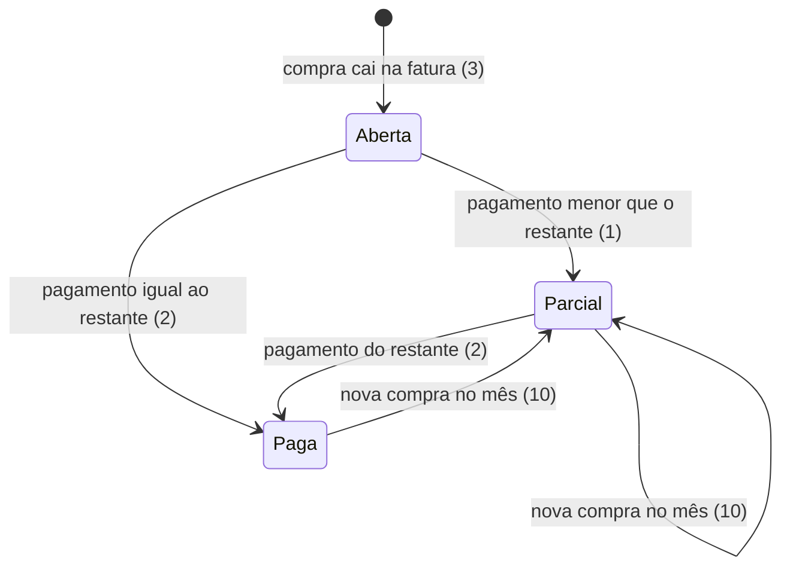

# Entrega 5 - Pagamento de fatura do cartão

> Build this with **tlc-implement**.
> Every criterion below becomes a check with a proof, referenced by its number. Nothing under
> `Unresolved` gets settled while building.

## Intent

Hoje a fatura do cartão só soma compras. Não há como registrar que ela foi paga, então o saldo da conta
e o limite do cartão ficam errados para sempre: a conta nunca é debitada e o limite nunca volta. Quem
paga é a família, que não consegue saber o que deve ao banco nem quanto de limite está disponível de
verdade. Pagamento parcial também não existe, e a fatura não tem como mostrar o que falta pagar.

Com esta entrega, a família escolhe uma conta, informa o valor e registra o pagamento de uma fatura
inteira ou de parte dela. A conta é debitada, o limite do cartão volta pelo valor pago, e a fatura mostra
o restante e o status `Aberta`, `Parcial` ou `Paga`. Pagamento não é despesa: não entra no extrato nem nos
totais (D18). O backup passa a guardar os pagamentos.

2 abertos, nenhum bloqueia · 28 critérios em 4 fatias · 2 portas sem retorno

## Criteria

### S1 - Pagamento parcial e total da fatura (API)

1. Dada uma fatura de R$ 1.000,00, quando recebe pagamento de R$ 300,00, então `GET /api/credit-cards/{cardId}/invoices` mostra `paidAmount` = `300.00`, `remainingAmount` = `700.00` e `status` = `Parcial`.
2. Dada a fatura do critério 1, quando recebe pagamento de R$ 700,00, então `remainingAmount` = `0.00` e `status` = `Paga`.
3. Dada uma fatura sem pagamentos, quando é listada, então `status` = `Aberta` e `paidAmount` = `0.00`.
4. Quando um pagamento de R$ 300,00 é registrado com conta de saldo R$ 5.000,00, então o saldo da conta vira R$ 4.700,00 e o `availableLimit` do cartão aumenta R$ 300,00.
5. Quando um pagamento é registrado, então `GET /api/transactions` não muda: pagamento não é despesa nem lançamento (D18).
6. Se `amount` é zero ou negativo, então `POST .../payments` responde `400` com `messages.amount` = `Valor deve ser maior que zero`.
7. Se `amount` é maior que `remainingAmount`, então responde `400` com `message` = `Valor maior que o saldo da fatura`, e saldo, limite e pagamentos não mudam.
8. Se não existe fatura para o cartão e o mês informados, então responde `400` com `message` = `Fatura não encontrada`.
9. Se `accountId` ou `profileId` não existe, então responde `400` com `message` = `Conta não encontrada` ou `Perfil não encontrado`.
10. Dada uma fatura parcialmente paga, quando uma nova compra cai nesse mês de fatura, então `remainingAmount` aumenta pelo valor da compra e `paidAmount` não muda.
11. Quando dois `POST .../payments` de R$ 1.000,00 chegam ao mesmo tempo para uma fatura de R$ 1.000,00, então exatamente um responde `201` e o outro `400` com a mensagem do critério 7.
12. Sempre, `paidAmount` ≤ `amount` da fatura (invariante garantida pelo critério 7 e pelo lock do critério 11).
13. Quando o backup é exportado em JSON e importado, então os pagamentos voltam com o mesmo valor, conta, perfil e data, e `remainingAmount` é igual ao de antes.
14. Quando o backup é exportado em CSV e importado, então o resultado é o mesmo do critério 13.

### S2 - Exclusão de compra e estorno de pagamento

15. Dada uma compra de R$ 150,00 numa fatura de R$ 1.000,00 com R$ 900,00 pagos, quando a compra é excluída, então responde `400` com `message` = `Fatura já tem pagamento que impede esta exclusão` e nada muda.
16. Dado um pagamento de R$ 300,00 de uma fatura de R$ 1.000,00, quando `DELETE /api/invoice-payments/{id}` é chamado, então responde `204`, o saldo da conta aumenta R$ 300,00, o `availableLimit` do cartão diminui R$ 300,00 e `remainingAmount` volta a R$ 1.000,00.
17. Se `DELETE /api/invoice-payments/{id}` recebe um id inexistente, então responde `400` com `message` = `Pagamento não encontrado`.
18. Dada a situação do critério 15, quando os R$ 900,00 pagos são estornados e a compra é excluída de novo, então a exclusão responde `204` e o `availableLimit` aumenta R$ 150,00.

### S3 - Faturas na tela

19. Quando o Resumo carrega com faturas não pagas, então cada fatura mostra o cartão, o mês, `Restante R$ x` e o status.
20. Quando não há fatura em aberto, então o Resumo mostra `Nenhuma fatura em aberto`.
21. Quando o usuário toca em "Pagar" numa fatura, então o formulário abre com o valor igual ao restante, a data de hoje, e a conta é obrigatória.
22. Quando o pagamento é salvo, então a tela mostra `Pagamento registrado` e o restante atualizado sem recarregar a página.
23. Quando a API responde `400`, então a tela mostra a mensagem recebida e mantém o valor digitado.
24. Enquanto o envio está em andamento, dois toques em Pagar geram um único pagamento.
25. Quando a fatura tem pagamentos, então a seção lista cada pagamento com data, conta e valor, e um botão "Estornar".

### S4 - Estorno na tela e celular

26. Quando o usuário toca em "Estornar", então aparece a confirmação `Estornar pagamento de R$ 300,00?` com `Cancelar` e `Estornar`, e nada é enviado antes de confirmar.
27. Quando o estorno é confirmado, então a tela mostra `Pagamento estornado` e o restante e a lista atualizados.
28. Em 375px, a seção de faturas não tem rolagem horizontal, e a tela continua nas três abas de entrega 4.

## States

## Out of scope

- Pagamento no extrato - D18; o pagamento aparece só na fatura (decidido em 11/10/2026)
- Editar um pagamento - estorno e novo pagamento cobrem a correção
- Telas de orçamento e metas - entrega 7

## Observable

| Surface | Decision | Landing |
| --- | --- | --- |
| section "Faturas" no Resumo | empty state | 20 |
| section "Faturas" no Resumo | error state | 23 |
| section "Faturas" no Resumo | loading state | Unresolved 1 |
| section "Faturas" no Resumo | destructive action confirms | 26 |
| form Pagar | error state (400) | 23 |
| form Pagar | loading state | 24 |
| API `POST .../payments` | error shape and codes | 6, 7, 8, 9 (400) |
| API `POST .../payments` | retry after timeout | n/a - sem retry automático, como na entrega 4; o duplo toque tem proof no critério 24 |
| API `DELETE /api/invoice-payments/{id}` | error shape and codes | 17 (400) |
| API `POST/DELETE` | who may call | existing - guard de PIN de `/api/**` |
| API `GET .../invoices` | error shape | 8 (400 quando não há fatura) |
| API | versioning | n/a - API sem versão |
| backup export/import | error shape | 13, 14 |

## Swept

- validation: 6, 7, 8, 9
- failure modes: 7, 8, 9, 15, 17
- idempotency and retry: 24 (duplo toque); retry após timeout não tem proof (mesmo risco da entrega 4)
- authorization: existing - guard de PIN de `/api/**` (entrega 3)
- concurrency and ordering: 11 (dois pagamentos simultâneos), 12 (invariante), 15 (exclusão vs pagamento)
- data lifecycle: 13, 14 (backup), 16 e 18 (estorno devolve saldo, limite e restante)
- external-dependency failure: n/a - sem serviço externo; falha do H2 tratada pelo Spring, como hoje
- state transitions: diagrama em States (1, 2, 3, 10, 16)
- observability: n/a - sem requisito de log nesta entrega

## Impact

| Front | What changes |
|---|---|
| domain | new term: `Pagamento de fatura` - valor pago de uma fatura por uma conta, por um perfil, numa data; vive em `account` |
| domain | existing term `Fatura`: ganha `paidAmount`, `remainingAmount` e `status` derivados; a fatura nunca tem status guardado |
| domain | existing term `Limite disponível`: antes só caía com compras; agora também volta com pagamentos. Quem lê o limite: o cálculo de compra em `CreditCardInvoiceService` e a tela de cartões |
| domain | existing term `Saldo da conta`: antes só mudava com lançamentos; agora também muda com pagamentos de fatura |
| stored data | nova tabela `invoice_payments` (migração `V4`): nada a migrar, faturas existentes ficam com `paidAmount` 0 |
| backup | `BackupExport` ganha a lista de pagamentos; JSON e CSV mudam (linha `INVOICE_PAYMENT`) |
| UI | Resumo ganha a seção "Faturas" |

## Decided

| Decision | Shape | Alternative rejected |
| --- | --- | --- |
| Pagamento em tabela própria, não em `Transaction` | tabela `invoice_payments (id, invoice_id FK credit_card_invoices, account_id FK bank_accounts, profile_id FK profiles, amount NUMERIC(19,2) NOT NULL, paid_on DATE NOT NULL)`; sem novo valor em `TransactionType` | novo `TransactionType.INVOICE_PAYMENT`: entra no extrato, nos totais e no formato de lançamento; pagamento não tem categoria nem cartão de origem, então o tipo forçaria condições em todo lugar |
| Status da fatura é derivado, nunca guardado | `remainingAmount` = `amount` − soma de `invoice_payments.amount`; `status` = `Aberta` se paid = 0, `Paga` se remaining = 0, `Parcial` caso contrário | coluna `status` gravada: duas fontes da verdade, uma delas pode ficar errada depois de uma compra nova ou de um restore |
| Contrato de pagamento e de listagem | `POST /api/credit-cards/{cardId}/invoices/{billingMonth}/payments` com `{accountId, profileId, amount, date}` → `201`; `GET /api/credit-cards/{cardId}/invoices` → lista de `{billingMonth, amount, paidAmount, remainingAmount, dueDate, status}` | pagamento por id de fatura: o id só existe depois que a fatura é criada, e a tela já tem cartão e mês |
| Estorno de pagamento como exclusão de linha | `DELETE /api/invoice-payments/{id}` remove a linha e reverte saldo, limite e restante; não cria lançamento de estorno | lançamento compensatório: aparece no extrato e polui os totais, contra D18 |
| Lock pessimista na fatura | `@Lock(PESSIMISTIC_WRITE)` ao carregar a fatura em pagamento e em estorno de compra | checagem sem lock: dois pagamentos simultâneos passam pelo mesmo `remaining` antes de qualquer gravação (critério 11) |

## Surface

| Route | In | Out | Status | Criteria |
| --- | --- | --- | --- | --- |
| `GET /api/credit-cards/{cardId}/invoices` | - | lista de faturas com `paidAmount`, `remainingAmount`, `status` | `200` | 1, 2, 3 |
| `POST /api/credit-cards/{cardId}/invoices/{billingMonth}/payments` | `accountId`, `profileId`, `amount`, `date` | pagamento (201); `message` ou `messages` (400) | `201`, `400` | 4, 6, 7, 8, 9, 11 |
| `DELETE /api/invoice-payments/{id}` | - | - | `204`, `400` | 16, 17 |

## Sources

- Linear COD-14, *Entrega 5 - Pagamento de fatura do cartão*, 10/10/2026 - fonte principal
- `docs/decisions.md` D17 (compra conta no mês da compra; saldo só muda na fatura paga), D18 (pagamento debita a conta, devolve o limite, não é despesa), D19 (exclusão com estorno), D34 (pagamento parcial permitido; restante em aberto; limite volta só pelo valor pago). Respostas de 11/10/2026: exclusão de compra com pagamento é recusada e o estorno de pagamento entra nesta entrega; pagamento não aparece no extrato
- Design - none: não há desenho da seção "Faturas"; copy e layout seguem o texto desta task (Unresolved 4)

This task is the record of decision. If a linked document diverges, ask before building.

## Unresolved

| # | Kind | Question | Until answered |
| --- | --- | --- | --- |
| 1 | open | Loading da seção "Faturas" e posição dela no Resumo. Default: seção no fim do Resumo, texto "Carregando faturas..." | Critérios 19 a 25 sem layout |
| 2 | open | Data do pagamento. Default: hoje, editável no formulário | Critério 21 usa a data de hoje |

Resolvidas em 11/10/2026: exclusão de compra com pagamento é recusada, o estorno de pagamento entra nesta entrega (critérios 15 a 18), e o pagamento não aparece no extrato (critérios 4 e 5).
